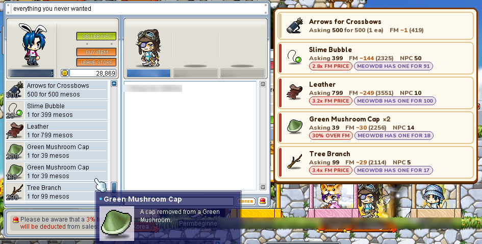

# MaplePrice Checker

A price overlay for MapleStory Classic. Open a player shop and it reads the
listings off the screen and shows you, right next to them, what each item goes
for on the Free Market and at the NPC — so you can tell a deal from a ripoff
without alt-tabbing to a wiki.



Prices come from the public [MeowDB](https://meowdb.com/msclassic) API. Everything
runs on your own PC — nothing you scan is uploaded anywhere.

## What it does

- **Shop scan** — reads a shop as it opens (or on `F8`) and labels each row with
  the FM price, NPC price, and how far the asking price is above or below FM.
- **Hover check** (`F7`) — rest the cursor on any item tooltip (inventory, NPC
  shop, FM) to price it.
- **Market dashboard** — a local web page of everything you've scanned (deals,
  price history, per-item charts). Opens from the `F10` window.

## Requirements

- Windows 10 or 11
- [Python 3.12](https://www.python.org/downloads/) (only to run from source — the
  built `.exe` needs nothing)

## Run it

```bat
py -3.12 -m pip install -r requirements.txt
py -3.12 run.py
```

**Run it as administrator.** MapleStory swallows key presses while it's the active
window, so the hotkeys only work if MaplePrice is elevated too. (Right-click your
terminal → *Run as administrator*, then run the command above.)

## Hotkeys

| Key | Does |
| --- | --- |
| `F8` | Scan the open shop |
| `F7` | Toggle hover price checks |
| `F9` | Clear the overlay |
| `F10` | Options (channel, FM room, hotkeys, dashboard) |

Shops also scan on their own as they open; turn that off in `F10` if you'd rather
only use `F8`. Close the console window to quit.

## Build a standalone .exe (optional)

So it runs without Python installed:

```bat
py -3.12 -m pip install pyinstaller
build.bat
```

The result is `dist\MaplePrice.exe` — one file, double-click to run (it asks for
admin by itself).

## Notes

- Built for the 1366×768-ish default client. Other sizes mostly work; the hover
  check is the most resolution-sensitive part.
- The first scan after launch is a touch slower while the OCR engine warms up.
- Logs, settings and the scan database live in `%LOCALAPPDATA%\mapleprice`
  (`log.txt` is the first place to look if something's off).
